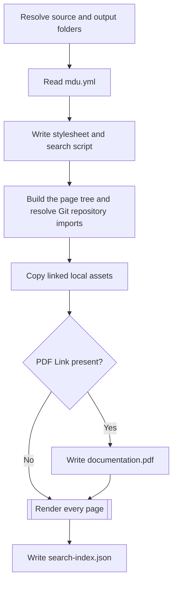
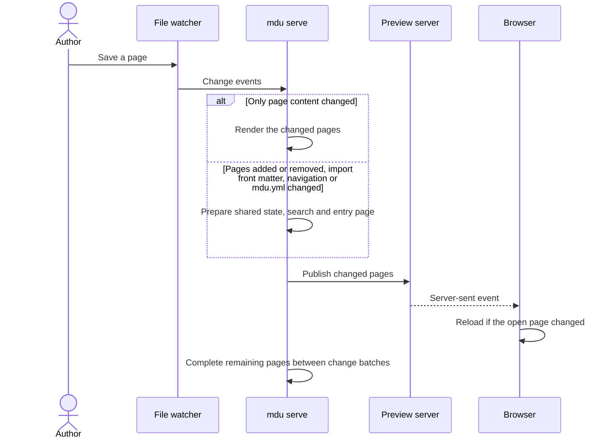

# Processing implementation

Most commands follow the same pattern: find the Markdown files, build a page tree, and walk it with one or more visitors. The visitors decide what a command does.

## Page tree

`GraphBuilder` turns the documentation folder into a tree of `MarkdownFile` nodes:

1. It lists the files that match the search pattern, `*.md` by default, folder by folder.
2. A folder's `README.md`, or else its `index.md`, becomes the parent of the other pages in that folder and of the pages in its subfolders.
3. A folder without such a page adds its pages to the nearest parent above it.
4. `DataPreparationVisitor` reads each page's level-one heading and front matter: `title`, `description`, `icon`, `openapi`, `mdu.import.source`, and the `navigation.*` settings.
5. `GraphBuilder` resolves Git repository imports and mounts each imported folder's page tree at the import page's position. Each imported page keeps its repository source path and its site-relative path.

```text
docs/
├── README.md          → root page
├── Setup/
│   ├── README.md      → child of README.md, parent of the pages below
│   ├── DotNet-Tool-Installation.md
│   └── Portable-Installation.md
└── Usage/
    ├── README.md      → child of README.md, parent of the pages below
    ├── render.md
    └── lint/
        ├── README.md  → child of Usage/README.md
        └── Rules.md
```

The tree is the single source for the sidebar, the top navigation, breadcrumbs, previous and next links, and the page order of the PDF. `mdu tree` prints it.

## Commands and visitors

| Command | Walks the tree with | Result |
| --- | --- | --- |
| `tree` | `PrintTreeVisitor` | Indented page titles |
| `lint` | `LinterVisitor`, then `LintResultRenderer` | Diagnostics as text, JSON, or GitHub annotations |
| `fix` | `LinterVisitor`, then `MarkdownCompatibility` and `MarkdownLinks` | Converted syntax, moved pages, and updated links |
| `render` | `LocalAssetsCopy`, `PdfCommand`, `MarkdigVisitor` | Static site and, when a PDF Link is present, `documentation.pdf` |
| `serve` | Same as `render`, then a file watcher | Preview site and a refreshed PDF when a PDF Link is present |
| `pdf` | The tree in navigation order, then `PdfRenderer` | One PDF file |

`mdu page move` and `mdu page links` need no page tree. They read every Markdown file below the documentation folder with `MarkdownLinks`, so they also see pages that are hidden from navigation.

## Rendering a site

`mdu render` runs these steps once and exits. Click a step to read more.



For each page, `MarkdigVisitor`:

- removes the front matter, expands any `openapi` code blocks into generated API references and companion specification pages, and adds the page text, split at its headings, to the search index;
- collects the navigation, top navigation, breadcrumbs, and last-changed date from the tree and git;
- lets `HtmlRenderer` write the page to a temporary file and then moves it into place, so a browser never reads a half-written page;
- writes `README.md` as `index.html`, and adds a small redirect page so that `Setup/` also reaches `Setup.html`.

Assets are found through the links on each page. Only linked local files are copied, with their relative paths unchanged; external URLs stay where they are.

## Live preview

The [quality requirements](Performance.md) define the responsiveness, startup, memory, and correctness targets for future optimization. The flow below describes the current implementation.

`mdu serve` prepares the complete navigation and search index, renders the entry page, and starts the local HTTP server. Other HTML pages are completed one at a time. A request for a pending page renders it before responding, so navigation and search results remain usable. The preview-only `/__mdu/status` endpoint distinguishes pending HTML work from complete-site readiness. Changes are collected for 20 ms and handled as one batch. If a deletion or rename leaves a known page temporarily missing, another 75 ms collects a replacement file, avoiding a site rebuild during a short atomic-save gap. Atomic replacements already complete within the first batch need no extra delay:



All affected source snapshots and prepared page expansions are invalidated before any batch parsing. If a batch fails, affected unfinished pages return an error rather than old HTML, and the next save rebuilds from current sources so later pages in the aborted batch are not lost. A failed pending page remains pending, is skipped by the background worker to avoid repeated failing work, and can be retried by a request or a new save. Render errors are logged and return HTTP 500; a failed page does not make the site ready. A replacement generation clears the old pending queue only after its new graph, search preparation and PDF planning succeed. Siblings rendered for new OpenAPI output names are removed from the old queue.

Static assets and PDF availability responses bypass the HTML rendering lock. PDF readiness remains global: a pending or failed download generation temporarily makes all generated PDF paths unavailable. HTML rendering, PDF sections and the final PDF assembly/write remain serialized; a single expensive section or final write can delay a request. These limits are separate from the ordinary no-PDF editing budgets.

`serve` remembers which assets and OpenAPI specifications each page references. When an image changes, it copies the new file and reloads only the pages that show it. Specification changes refresh their referencing pages, companion specification pages, search entries, and linked PDFs. Unrelated HTML stays untouched unless shared metadata changes. A changed import page triggers a rebuild and resolves its repository URL again; restarting `serve` picks up remote branch changes when no local import page changed. Files that disappear from the site are removed from the output folder.

Markdown is held as a stable per-page snapshot for a build and invalidated when that page or its specification changes. Media-provider membership and PDF-link analysis are retained per page; ordinary edits do not render all other pages to rediscover them. Changing the site's provider membership still refreshes every page's shared consent dialog. Navigation entries are prepared once per rendering visitor, and immutable HTML template parts are reused and streamed to the output writer.

Requests, changed pages, and background HTML work share a serialized renderer. A new batch takes priority over the next background page; a new shared rebuild replaces the pending work of its predecessor. Changed pages leave that queue before rendering, preventing prepared older content from overwriting the update. Prepared HTML inputs are released as pages finish, and all pending state is released when the generation completes.

The OpenAPI parse cache retains at most 128 documents and 8,388,608 UTF-16 source characters (16 MiB of source text); larger individual inputs are parsed without retention. Parsed object graphs add memory beyond the source-text budget. Eviction affects reuse, not correctness: each hit still requires the current content hash. Syntax-highlighter cache keys are the finite built-in grammar factories, so arbitrary unknown language names cannot accumulate entries. Fixed regex patterns in the main HTML and diagram paths use .NET source generation to avoid runtime regex compilation.

One preview also retains its Git commit-date map. Uncommitted body edits reuse it; HEAD, loose/packed refs, shallow state and repository/worktree configuration invalidate it. Linked worktrees and detached HEADs are supported. History/path/configuration overrides, replacement/grafted histories, reftable storage and metadata files larger than 64 KiB use the original Git query instead. The map is scoped to one preview and checked again after a query to avoid retaining a result across a concurrent commit.

When Markdown content changes, `serve` refreshes `documentation.pdf` if a PDF Link remains in the project. Adding the first link creates the file; removing the last link deletes it.

PDF layout runs one source section at a time after pending HTML, yielding to requests and changed inputs between sections. Source validation and expansion prepare the job; final serialization and atomic replacement finish it. A new content generation discards the old rendering sessions, including when the new source is invalid. Rendering stays serialized with HTML, so shared icons, glossaries and diagram limits cannot change in the middle of an active section.

The preview's status message and reload stream expose PDF states (`pending`, `ready`, `failed`, `none`). While the download batch is pending or failed, generated PDF requests return HTTP 503 with a clear message and retry information instead of stale bytes. Removing links removes obsolete files. Large individual sections and final PDF serialization remain indivisible work and belong to separately labelled PDF budgets. `mdu render` still completes every HTML, search, asset, and required PDF output before succeeding.

## PDF export

`mdu pdf` builds the same page tree and orders it like the navigation. PDF-hidden content is removed before the HTML pipeline renders each page as a fragment. AngleSharp parses that fragment using HTML rules; `PdfHtmlDocument` copies the resulting nodes into the XML representation used by `PdfRenderer`, omitting scripts, styles, and templates. The renderer lays out those elements on A4 pages and writes the PDF file itself. A folder export adds a title page and a linked table of contents. See [Rendering](Rendering.md#pdf-output) for the details.

## Linting and fixing

`LinterVisitor` checks each page in the tree. It reads the page's links with `Markdown.Document` and runs the [validators](Components.md#markdown.linter) for titles, link casing, and link targets. It checks rules that depend on the tree itself, such as duplicate pages, section pages, duplicate navigation titles, and navigation placement. The results go to a receiver, which `LintResultRenderer` then prints in the chosen format.

`mdu fix` runs the same linter, then applies what it can fix: it converts MkDocs Material syntax, renames `index.md` pages, creates missing section pages, and moves pages flagged by `MDU006`. Whenever a page moves, `MarkdownLinks` rewrites the links to it and the relative links inside it.
