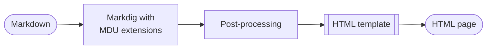
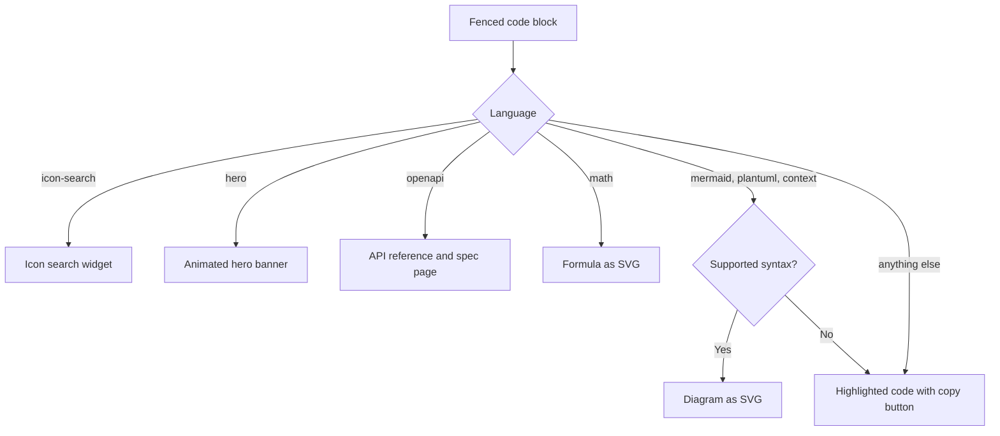

# Rendering implementation

`Markdown.Renderer` turns the Markdown of one page into a complete HTML page, or into PDF content. The page tree supplies everything around the content, such as navigation and breadcrumbs; the renderer supplies the content itself and the page frame.

Pages with `openapi` fenced code blocks have each block expanded into a generated API reference before rendering. `OpenApiMarkdownRenderer` reads a local JSON or YAML specification file or parses an inline specification, emits a companion static specification page with the full syntax-highlighted source, and hands the combined content to the normal HTML and PDF renderers. Large specifications repeat the same examples and schemas across many responses, so the HTML renderer emits a tab content that occurs more than once only once as a `<template>`. The page script copies it into an Example, Schema, or Schema JSON tab when that tab becomes visible in an open endpoint, and restores the schema anchor prefix of each media type in the copy. See the [OpenAPI feature](../../Features/OpenAPI.md) for its usage and supported content.

## From Markdown to HTML



1. **Parse.** Markdig parses the page with the extensions listed below.
2. **Rewrite links.** Relative links to `.md` files point to the rendered `.html` pages; `README.md` becomes `index.html`. Anchors and query strings are kept.
3. **Render.** Markdig writes the HTML. Code blocks go through MDU's own [code block renderer](#code-blocks).
4. **Post-process.** Standalone video links become consent placeholders, a full-width hero moves above the page layout, headings get permalinks, and the *On this page* list is collected.
5. **Fill the template.** The embedded `main.html` contains placeholders such as `%%MARKDOWN%%`, `%%NAVIGATION_ITEMS%%`, and `%%PAGE_BREADCRUMBS%%`. `HtmlRenderer` replaces them directly with HTML-encoded values.

## Markdig extensions

| Extension | Adds |
| --- | --- |
| Markdig advanced extensions | Pipe and grid tables, footnotes, task lists, emphasis extras, heading IDs, automatic links, and attribute lists |
| `HeadingIdExtension` | Keeps a leading number in heading IDs, as GitHub and MkDocs do: `## 3.1 Overview` gets `31-overview` |
| `ScrollableTableExtension` | Wraps wide tables in a horizontally scrollable container |
| `RenderedMathExtension` | [Math](../../Features/Math.md) as inline SVG |
| `GitHubAlertExtension` | [Callouts](../../Features/Callouts.md) with GitHub's alert syntax |
| `ShortcodeExtension` | [Icons and emojis](../../Features/Icons-and-Emojis.md) from shortcodes |
| `KeysExtension` | [Keyboard keys](../../Features/Keyboard-Keys/README.md) such as ++ctrl+alt+del++ |
| `HighlighterExtension` | The code block renderer below |

## Code blocks

Every fenced code block passes through one renderer, which picks the output by the block's language:



Because a diagram that cannot be rendered stays a code block, a page never breaks on unknown syntax. `mdu lint` reports unsupported Mermaid syntax as `MDU010`.

## Page assets

Every page links the shared `css/main.css` and local runtime scripts. `SiteAssets` writes each script or stylesheet once per site generation into the reserved `_mdu/` folder; feature-specific files are added only when a page needs them. Pages reference generated files, including `css/main.css` and `js/search.js`, with a content version (`_mdu/js/navigation.js?v=…`), so after a deployment or an mdu update browsers and CDNs do not combine new pages with cached old navigation, scripts, or styles. Scripts execute at the same positions in the document as their inline counterparts, preserving early theme and layout initialization.

| Asset | Added when |
| --- | --- |
| `js/search.js` and `search-index.json` | Always; the search runs directly in the browser |
| Icon search script and index in `js/` | A page contains an `icon-search` block |
| `_mdu/js/navigation.js` and `_mdu/sitemap.html` | Once for the site's navigation tree |
| Hero styles in `_mdu/css/` and shared WebGL runtime in `_mdu/js/` | A page contains a `hero` block |
| Beach or abstract Hero effects in `_mdu/js/` | A banner uses that effect group; playgrounds include both |
| Hero playground controls in `_mdu/js/` | A banner has `playground: true` |
| Dashboard styles and script | A page uses the dashboard layout |
| OpenAPI and isometric interaction scripts | A page contains the corresponding interactive content |
| Media consent script in `_mdu/js/` | The site contains a supported media provider |
| `_mdu/css/theme.css` | Custom theme colors are configured |
| Logo and favicon assets from `mdu.yml` | A logo or favicon is configured |

A rendered site looks like this:

```text
site/
├── index.html
├── search-index.json
├── css/
│   └── main.css
├── js/
│   └── search.js
├── _mdu/
│   ├── sitemap.html
│   ├── css/
│   └── js/
│       ├── navigation.js
│       └── …
├── assets/
│   └── logo.svg
└── Usage/
    ├── index.html
    └── render.html
```

## In the browser

The generated site consists of static HTML and shared local assets. Small local scripts add:

- light and dark themes, with an automatic mode that follows the operating system;
- the collapsible sidebar, top navigation tabs, and a drawer on narrow screens;
- client-side search with links to the matching section and highlighted hits;
- copy buttons for code blocks and footnote previews;
- the consent dialog for embedded videos.

`SiteNavigation` renders the navigation markup in C# once. The shared script inserts that markup before navigation controls initialize, adjusts relative URLs, and applies the page's current/ancestor/top-section state. It needs no fetch request or server endpoint and also works when opening a local HTML file. Page state uses URLs rather than positions in the tree, so a structural rebuild cannot accidentally highlight a different entry on a page awaiting refresh. Ordinary `serve` content edits leave the shared navigation and runtime files untouched; navigation changes rebuild them after the new generation has been prepared, right before its pages render. `serve` removes shared files that no page uses any more when the site is rebuilt.

Breadcrumbs, previous/next links, and a link at the end of each page remain static. `_mdu/sitemap.html` contains the complete, expanded navigation without toggle buttons, including when JavaScript is disabled or the navigation script fails to load; it follows the site's theme colors and the reader's light or dark choice. The `_mdu` output folder is reserved for files generated by mdu; rendering stops with an error if the documentation contains a `_mdu` folder or a page would be written into it. No general HTML minifier touches user content, code whitespace, or PDF fragments.

The image viewer is the shared file `js/image-lightbox.js`. Pages with images load it, unless the page turns the viewer off and no image turns it back on. The build writes the file only when a page loads it.

Theme colors from `mdu.yml` become CSS custom properties. Secondary colors, lines, and hover backgrounds are mixed from them in CSS, so a custom palette stays consistent.

The header contains both configured logo variants when they differ. CSS selects the current theme's variant before the first paint, without cloning or swapping images in JavaScript. A full-width beach overrides that selection only while it lies under the transparent header and the mobile navigation drawer is closed; abstract and content-width heroes keep the normal theme selection.

Hero effects share one WebGL lifecycle for lazy initialization, resizing, animation, visibility, reduced motion, and context recovery. The beach supplies its existing shader and lighting uniforms; abstract effects use the site's background and text palette. Custom fragment shaders are HTML-encoded inside inert `<template>` elements, never interpolated into executable JavaScript. Only the optional playground exposes editing controls; it uses the same runtime as ordinary banners. Live appearance changes update uniforms without rebuilding the program. A full-width playground leaves an inert position template in the article. Its width switch moves the existing banner, canvas, and controls between that position and the header, preserving the WebGL controller and enforcing one full-width banner per page. A layout event updates header and scroll geometry; CSS reacts to the resulting state to select the logo. Secondary settings and YAML are collapsed initially; preview/return controls navigate to the actual banner without a second rendering context. Shader edits compile after a 300 ms typing pause; a replacement program is committed only after successful compilation and linking. Failed edits show an error and preserve the last valid preview. The [Hero feature page](../../Features/Hero.md) is also its playground. PDF rendering skips these templates.

## PDF output

`PdfRenderer` reuses the HTML pipeline for `mdu pdf` and for PDF downloads generated by `mdu render` and `mdu serve` when the project contains a PDF Link. PDF-hidden content is removed from the Markdown before it is rendered as an HTML fragment. AngleSharp parses the fragment using HTML rules; `PdfHtmlDocument` omits scripts, styles, and templates and copies the resulting nodes into the XML representation used by the PDF layout. The layout then places the blocks on A4 pages. Tables keep their inline styles and links, and diagrams and formulas are drawn from their SVG paths. Content pages repeat the document title in a running header and show page numbers with the total count in the footer. The writer uses the standard fonts built into every PDF reader for compact files; emojis appear as their shortcodes. Links between included pages become internal PDF links.
