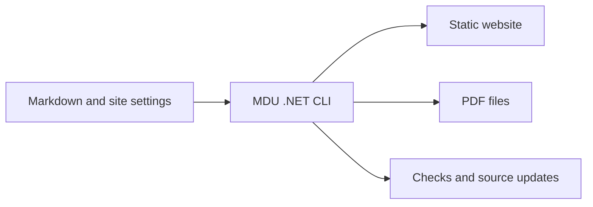

# Architecture

MDU turns ordinary Markdown into a documentation site and PDF files. One .NET command-line tool reads the sources, checks them, and produces files ready for a static web host.

## Design principles

| Principle | What it means |
| --- | --- |
| Portable sources | Documentation stays readable as ordinary Markdown. |
| Static output | HTML, CSS, SVG, search data, and local JavaScript work on a static host. |
| One development framework | MDU and its own development/build tools use .NET. |
| Scriptable commands | Plain-text output and exit codes support local use and CI. |

The [technology decision](Technology.md) defines the permitted tools and the consent requirement for external video players.

## Quality requirements

The preview should start quickly and show saved changes promptly. The latest save wins; navigation and search stay consistent, and unfinished downloads are clearly identified. Repeated editing should keep memory use bounded.

[Performance benchmarks](Benchmarks.md) contains the **starting commands and the target-versus-measured table**. It also explains which measurements describe the native release and which describe framework-dependent execution.

## Explore the architecture

- [Components](Components.md) — the responsibilities of the main building blocks
- [Processing pipeline](Pipeline.md) — how sources become output and how previews update
- [Rendering](Rendering.md) — what MDU generates and what happens in the browser
- [Technology decision](Technology.md) — the development and static-site constraints
- [Implementation details](Details/README.md) — optional project maps, algorithms, and measurement methods
