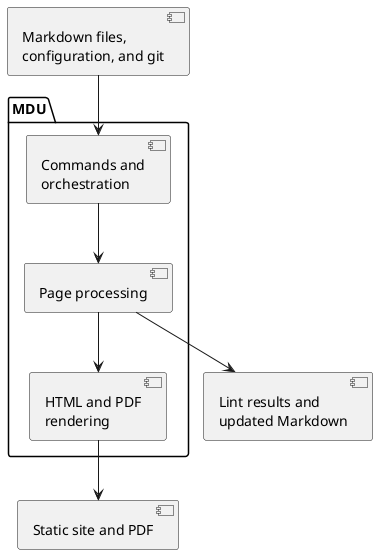

# Architecture

MDU is a single .NET tool. It reads a folder of ordinary Markdown files, builds a page tree from the folder structure, and then lints, renders, or rewrites those pages. Everything a published site needs is produced at build time, so the result is a folder of static files.

## Design principles

| Principle | What it means |
| --- | --- |
| **Portable sources** | Pages stay plain Markdown that reads well on GitHub. MDU features use code blocks, shortcodes, or front matter that degrade to readable text elsewhere. |
| **Static output** | Diagrams, math, icons, and syntax highlighting become HTML and SVG at build time, ready for any static web host and offline viewing. |
| **Built-in renderers** | One `dotnet tool` renders HTML, diagrams, math, syntax highlighting, and PDF files directly in .NET, without external language runtimes or a browser engine. |
| **Scriptable CLI** | Commands print plain text and return exit codes; `mdu lint` also writes JSON and GitHub annotations. |
| **One development framework** | Own tools, generators, benchmarks, tests, and builds use .NET. Published behavior uses static HTML, CSS, and local JavaScript; see the [technology decision](Technology.md). |

## Quality requirements

MDU should make documentation editing feel immediate: an open preview should show the latest saved content promptly, including while other pages are being rebuilt. Initial startup should quickly produce a usable page. Work for a local edit should depend mainly on the affected content and its dependencies, rather than the total number of pages.

The following values are **development targets, not performance guarantees or claims about the current implementation**. They guide optimization and acceptance checks. The [baseline investigation in issue #188](https://github.com/capjan/mdu/issues/188) records the starting point; its report, raw observations, and reproduction instructions are in `Tools/Performance/` in the repository.

### Performance targets

The reference environment is an Apple M4 with 16 GiB RAM, macOS arm64, .NET SDK 10.0.403 / runtime 10.0.14. Following the execution-format review, acceptance uses the shipped native .NET release build. Framework-dependent portable execution is measured separately. The original baseline sites contain 6, 53, and 503 Markdown pages, with diagrams, OpenAPI, highlighted code, and icons. Documentation growth changes the small/documentation counts; comparisons must freeze and identify their inputs. The large site repeats fixed content templates; it does not represent every possible 500-page site. Comparisons must record the source revision, corpus, runtime settings, output state, and filesystem-cache conditions.

| Measurement | Development target |
| --- | --- |
| Ordinary text edit until updated HTML is available over HTTP | Median at most 50 ms; p95 at most 100 ms |
| Ordinary text edit until the new content is displayed in the open browser | p95 at most 150 ms |
| Ordinary diagram or OpenAPI edit until the new content is displayed | p95 at most 300 ms |
| Fresh `serve` startup until the first usable preview page | Median at most 250 ms for the small reference site; at most 1 s for the large site |
| Complete `render` of the large reference site | Median at most 2 s |
| Cumulative managed allocations during an ordinary text edit | At most 10 MiB |
| Memory during extended editing | Bounded retained state; no sustained growth after warm-up for a fixed workload |

The portable framework-dependent build has separate startup/build budgets on the same machine: median first usable preview at most 750 ms for the small site and 1.5 s for the large site; complete large render at most 5 s. The ordinary edit, display, allocation and retention targets remain the same. These budgets provide explicit headroom over the measured portable checkpoint; they do not replace the native acceptance values or imply identical startup behavior across formats.

An ordinary edit changes one page without changing the shared navigation or site configuration. The initial expensive-content cases use a 12-component diagram or an eight-operation API specification affecting one page. Large specifications, more complex diagrams, shared dependencies with many consumers, PDF generation, remote imports, and slow storage require separately labelled workloads and budgets. A fast update of the open page does not imply that every affected output is already complete.

The baseline for the large reference site was about 326 ms until a text edit became available over HTTP, 4.19 s until the initial HTTP response, 4.09 s for a complete render, and 1,120 MiB allocated per warm text edit. Browser display latency was not measured. These observations are distinct from the targets above and do not establish p95 performance.

Reference acceptance on 2026-11-02 meets the native and separate portable budgets for the frozen 7/54/503-page corpora. The 503-page native run measured a 403 ms first usable preview, 1.31 s complete render, and 90 ms p95 text display latency (300 edits across three processes). A separate 600-edit native run observed 4.3 MiB median text-edit allocation and stabilized retained memory. The repository's `Tools/Performance/results/2026-11-02-acceptance.md` contains raw-data links, exact source/environment, outliers, PDF/Git checks and limits; these are measured reference results, not universal guarantees.

### Architectural constraints

| Requirement | Consequence for optimization |
| --- | --- |
| **Local work for local edits** | Reuse valid per-page analysis and shared navigation preparation. Refresh the affected dependency set; avoid rendering unchanged pages solely to rediscover media providers or PDF links. |
| **Latest saved content wins** | Coalesce repeated file events without delaying updates indefinitely. Older work must never overwrite a newer result. Temporary or invalid saves must recover on the next valid save without restarting `serve`. |
| **Responsive scheduling** | Prioritize open preview pages during larger rebuilds. New edits must not wait behind an unbounded queue of obsolete work. |
| **Honest readiness** | Listening on a port is not a usable preview. Report first usable page and complete-site readiness separately; navigation and search must remain correct as pages become available. `mdu render` succeeds only when all required outputs are complete. |
| **Consistent output** | Preserve atomic page replacement, links, anchors, navigation, search results, media consent, and PDF behavior, including strict `pdf-hidden` validation. If expensive downloads are updated separately, their readiness and revision must be clear rather than silently serving stale content. |
| **Bounded reuse** | Invalidate saved results when their inputs or dependencies change; release obsolete entries after changes and deletions. Large cached results need explicit memory limits. |

Per-page snapshots, retained media/PDF analysis, dependency-scoped updates, early HTML preview, prioritized pending pages and cooperative PDF layout implement these constraints. The [processing pipeline](Pipeline.md#live-preview) describes current behavior and limits.

### Verification and regression checks

Measure the user-visible path from the on-disk save through file detection, processing, reload notification, browser reload, and display of the expected new content. Record HTTP availability and complete rebuild time separately. Preserve first-edit observations as well as steady-state results. A percentile target describes a distribution, not a maximum for every save; p95 means 95% of observations meet the stated limit.

Use at least 300 edit observations across multiple server processes for p95 acceptance checks. Exercise direct writes and editor-style atomic saves, rapid consecutive edits, changes during a rebuild, additions and deletions, invalid intermediate content, shared configuration, external OpenAPI dependencies, Git metadata, imports, and projects with PDF links. Record fresh-process startup and repeated edits independently, with enough samples to show spread. Compare on the same environment and repeat suspected regressions.

Measure allocation volume, peak process RSS, and retained managed memory separately. Normal timed runs must not force garbage collection or include diagnostic instrumentation. For retention checks, use separate runs with idle checkpoints and long mixed edit sequences. The initial baseline showed stabilization during repeated body edits, but did not establish a plateau for mixed changes; an RSS peak alone is not evidence of a leak.

Every optimization must pass output and behavior checks as well as timing checks. Start with byte-identical output where applicable; when output organization changes, verify equivalent content and behavior explicitly. Browser checks must cover search, navigation, keyboard focus, and media consent acceptance and revocation. A faster internal stage is insufficient if end-to-end latency, memory use, or correctness regresses. The native .NET harness measures browser timing and checks these interactions; larger acceptance runs remain necessary before claiming the targets.

## System context

MDU sits between the documentation author and the published site. Click a node to read more.

```context
accTitle: MDU system context
Mdu[MDU<br>mdu command]
actor Author as Documentation author
Author -. lints, previews, renders .-> Mdu
Source[Markdown pages<br>and assets] --> Mdu
Config[mdu.yml<br>site settings] --> Mdu
Git[Git history] --> Mdu
Mdu --> Site[Static HTML site]
Mdu --> Pdf[PDF document]
Ci[CI pipeline<br>GitHub Actions, GitLab CI] -- runs --> Mdu
click Source href "../Features/README.md"
click Config href "../Usage/render.md#site-configuration"
click Git href "../Features/Navigation.md#page-footer"
click Site href "Rendering.md"
click Pdf href "../Usage/pdf.md"
click Ci href "../Publish/README.md"
```

- **Inputs** are the Markdown pages with their linked images and files, an optional `mdu.yml`, and the git history, which provides the *last changed* date of each page.
- **Outputs** are a static site that any web server can host, a single PDF document, lint reports, or rewritten Markdown files after `mdu fix` and `mdu page move`.

## Building blocks

MDU has three main parts. Select a block to open its detailed view.



## In this section

- [Components](Components.md) - What each project does and which libraries it uses
- [Processing Pipeline](Pipeline.md) - How commands build the page tree, render a site, and refresh the live preview
- [Rendering](Rendering.md) - How a Markdown page becomes an HTML page with diagrams, math, and icons
- [Technology decision](Technology.md) - The .NET-only development rule, static website constraints, and approved exceptions
