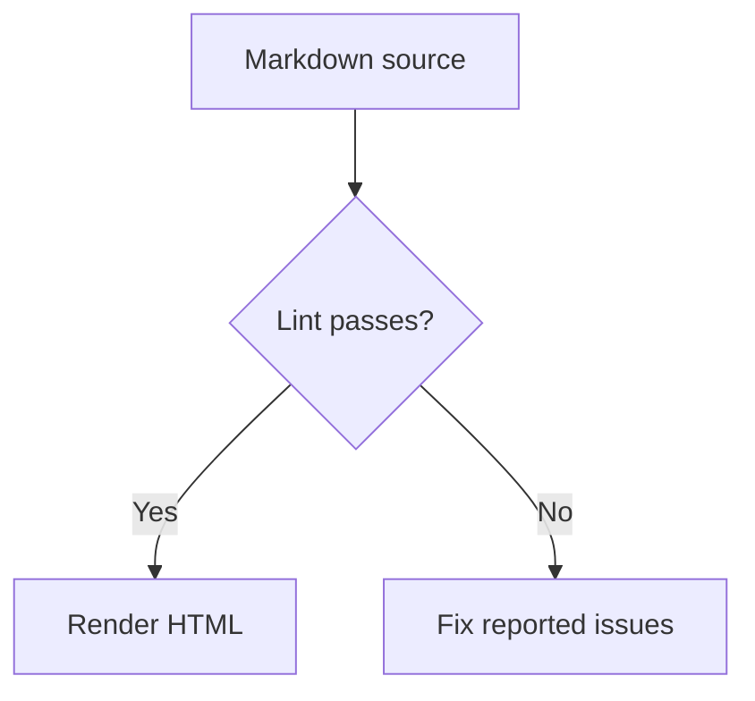
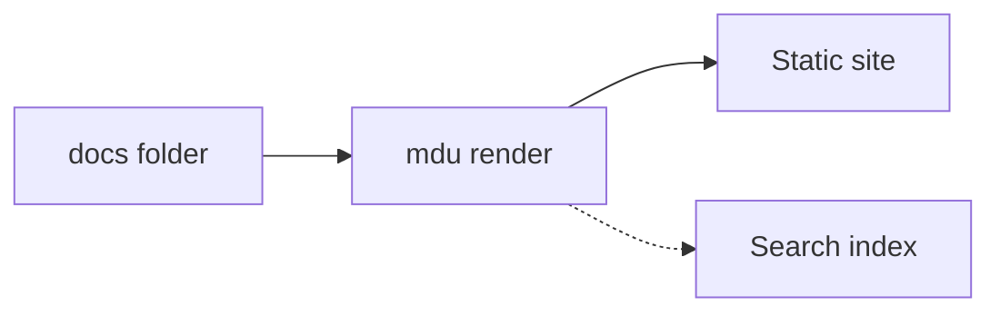
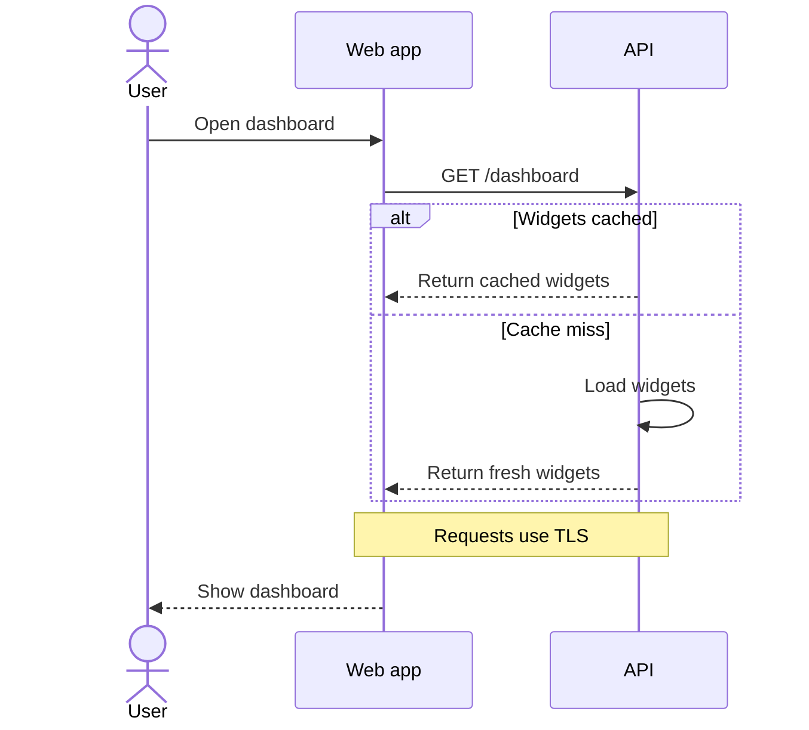
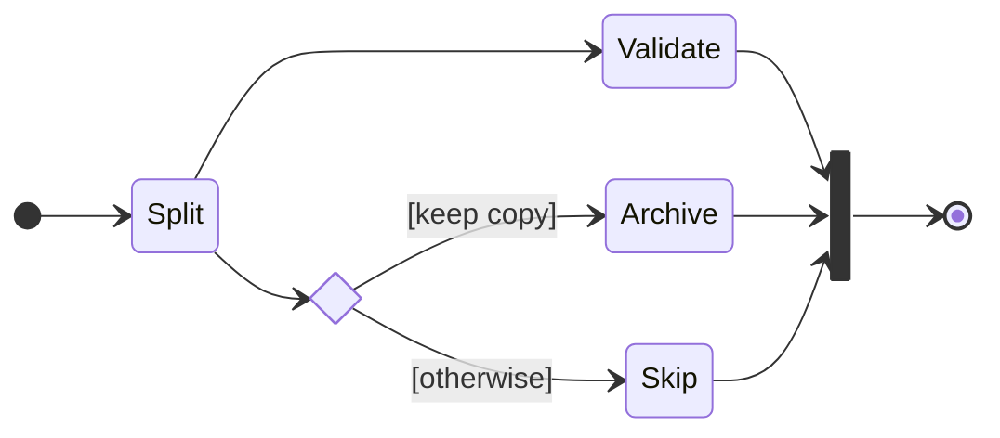
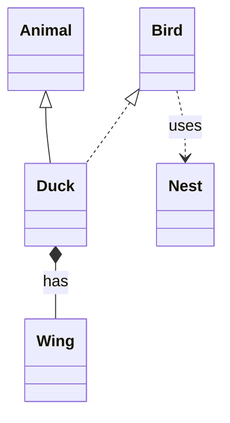
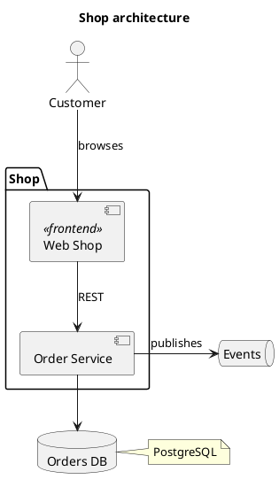
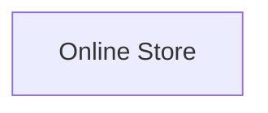
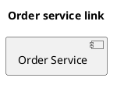

# Diagrams

Write diagrams as text; MDU turns supported code blocks into static SVG in the rendered page.

- Rendered to static SVG at build time
- Works offline
- Follows the light or dark theme
- Keeps diagram sources portable Markdown

> [!NOTE]
> MDU uses its own renderers for subsets of Mermaid and PlantUML. The output can differ from those tools, and unsupported syntax is not rendered as a diagram.

| Type | Use for | Code block | Also renders with |
| --- | --- | --- | --- |
| [Flowchart](#flowcharts) | Processes and decisions | `mermaid` | Mermaid, GitHub |
| [Sequence](#sequence-diagrams) | Interactions over time | `mermaid` | Mermaid, GitHub |
| [State](#state-diagrams) | States and transitions | `mermaid` | Mermaid, GitHub |
| [Class](#class-diagrams) | Types and relationships | `mermaid` | Mermaid, GitHub |
| [Component](#component-diagrams) | Architecture building blocks | `plantuml` | PlantUML |
| [Context](#context-diagrams) | A system in its environment | `context` | MDU exclusive |
| [Isometric](#isometric-diagrams) | Platforms and data flows in phases | `isometric` | MDU exclusive |

## Flowcharts

Use a `mermaid` code block for processes and decisions.

~~~markdown title="Markdown"

~~~


Use `LR` for a diagram that flows from left to right:

~~~markdown title="Markdown"

~~~


### Flowchart syntax

| Element | Syntax | Meaning |
| --- | --- | --- |
| Header and direction | `flowchart TD`, `graph LR` | `TD`/`TB` top to bottom, `BT` bottom to top, `LR` left to right, `RL` right to left |
| Node shapes | `A[Text]`, `A(Text)`, `A([Text])`, `A((Text))`, `A{Text}`, `A[[Text]]`, `A{{Text}}` | Rectangle, rounded rectangle, stadium, circle, diamond, subroutine, and hexagon |
| Namespaced IDs | `target:App` | Adds one namespace prefix to a node ID |
| Labels | `A["Text [with brackets]"]`, `A[First<br>Second]` | Double quotes allow brackets in labels; `<br>` starts a new line |
| Solid links | `-->`, `---`, `<-->`, `--o`, `--x` | Arrow, plain line, arrows at both ends, circle end, cross end |
| Dotted links | `-.->`, `-.-` | Dotted arrow or plain dotted line |
| Thick links | `==>`, `===` | Thick arrow or plain thick line |
| Link labels | `A -->|Yes| B` or `A -- Yes --> B` | Adds explicit text to a link |
| Chains and groups | `A --> B --> C`, `A & B --> C` | Chains links or connects multiple source nodes to one target |
| Subgraphs | `subgraph Services ["Services"]` … `end` | Groups nodes within the flowchart |
| Accessible title | `accTitle: Text` | Sets the accessible title |
| Comments | `%% comment` | Ignores the line |

Longer links made by adding dashes, dots, or equals signs span more layout ranks. MDU does not support every Mermaid flowchart shape or statement. Node links are covered under [Clickable nodes](#clickable-nodes).

## Sequence diagrams

Use a `mermaid` code block to show messages between participants over time.

~~~markdown title="Markdown"

~~~


### Sequence syntax

| Element | Syntax | Meaning |
| --- | --- | --- |
| Participants | `participant A`, `participant A as Label`, `actor A`, `actor A as Label` | Declares a participant or stick-figure actor, optionally with a display label |
| Messages | `->`, `-->`, `->>`, `-->>`, `-x`, `--x`, `-)`, `--)`, `<<->>`, `<<-->>` | `-` draws a solid line and `--` a dotted line; `>>` adds an arrowhead, `x` a cross end, `)` an open end, and `<<…>>` arrowheads at both ends |
| Line breaks | `A->>B: First<br>second`, `Note over A: First<br>second` | Starts a new line in a message or note |
| Activations | `activate A`, `deactivate A`; `A->>+B: Text`, `A->>-B: Text` | Starts or ends an activation; `+` activates the target and `-` deactivates the source |
| Notes | `Note left of A: Text`, `Note right of A: Text`, `Note over A,B: Text` | Places a note beside one participant or over one or two |
| Blocks | `loop`, `alt`/`else`, `opt`, `par`/`and`, `critical`/`option`, `break`, `rect` … `end` | Groups messages in a control block |
| Numbering | `autonumber`, `autonumber 10 5`, `autonumber off` | Numbers messages, optionally setting the start and step, or turns numbering off |
| Titles | `title Text`, `accTitle: Text` | Sets the visible title or accessible title |
| Comments | `%% comment` | Ignores the line |

Blocks end with `end`. `rect` draws a highlighted area, but its color argument is ignored. `box`, `create`, `destroy`, and participant links are not supported.

## State diagrams

Use `stateDiagram-v2` or `stateDiagram` in a `mermaid` code block to show a system's states and transitions. MDU draws both headers with its own static SVG renderer.

~~~markdown title="Markdown"
```mermaid
stateDiagram-v2
    accTitle: Document lifecycle
    [*] --> Draft
    state "In review" as Review {
        [*] --> Pending
        Pending --> Approved: approve
        Pending --> Pending: request changes
        Approved --> [*]
    }
    Review: Waiting for approval
    Draft --> Review: submit
    Review --> Draft: revise
    Review --> Published: publish
    Published --> [*]
    click Published href ../Usage/render.md
```
~~~

```mermaid
stateDiagram-v2
    accTitle: Document lifecycle
    [*] --> Draft
    state "In review" as Review {
        [*] --> Pending
        Pending --> Approved: approve
        Pending --> Pending: request changes
        Approved --> [*]
    }
    Review: Waiting for approval
    Draft --> Review: submit
    Review --> Draft: revise
    Review --> Published: publish
    Published --> [*]
    click Published href ../Usage/render.md
```

Composite states contain their own diagram. Their frames grow around their contents, and transitions between composites connect to their frames. The description below the display name adds context to the review state. The Published state links to the render command documentation using an unquoted `href` destination.

Choice nodes show conditional paths; fork and join bars split and merge transitions:

~~~markdown title="Markdown"

~~~


### State syntax

| Element | Syntax | Meaning |
| --- | --- | --- |
| Header | `stateDiagram-v2`, `stateDiagram` | Starts a state diagram |
| States | `Idle`, `state Idle`, `state "Waiting for input" as Idle` | Declares a state, optionally with a display label; transitions also introduce states |
| Descriptions | `Idle: Waiting for input` | Sets the label, or appends to an explicit display name; repeated descriptions add lines |
| Transitions | `Idle --> Active`, `Active --> Active: retry` | Draws an arrow, optionally with a label; self-transitions and cycles are supported |
| Start and end | `[*] --> Idle`, `Active --> [*]` | Draws a start circle or final double circle, local to each composite |
| Composite states | `state Active {` … `}` | Groups states; composites may be nested and may use quoted aliases |
| Choice | `state Decision <<choice>>` | Draws a diamond; conditions can be written in transition labels |
| Fork and join | `state Split <<fork>>`, `state Merge <<join>>` | Draws a bar perpendicular to the flow direction |
| Direction | `direction TB`, `direction BT`, `direction LR`, `direction RL` | Sets the direction of the current diagram or composite; `TD` is an alias for `TB`; each scope defaults to top to bottom |
| Links | `click Idle href details.md`, `click Idle "https://example.com/"` | Links a state or composite frame; see [Clickable nodes](#clickable-nodes) |
| Line breaks | `<br>` or `\n` in labels | Starts a new line |
| Accessible title | `accTitle: Text` | Names the diagram for assistive technology |
| Comments | `%% comment` | Ignores the rest of the line, outside quotes |

Write one statement per line, optionally followed by a semicolon. State IDs use letters, digits, underscores, and hyphens and must be unique across the diagram. Transitions stay within a composite's scope; connect the composite states themselves to cross their boundaries. State links accept quoted destinations or unquoted destinations after `href`, and an optional ignored tooltip. A linked composite has the same full-frame click area in HTML and PDF; its child links retain their own destinations. Mermaid front matter may follow leading blank lines and `%%` comments. Custom styles and `:::` class suffixes are ignored so states follow the page theme.

Notes, concurrent regions (`--`), history states, JavaScript callbacks, and multiline `accDescr` blocks are not supported. These statements keep the whole diagram as a code block and produce `MDU010` during linting.

## Class diagrams

Use `classDiagram` or `classDiagram-v2` in a `mermaid` code block to show types and their relationships.

~~~markdown title="Markdown"

~~~


### Class syntax

| Element | Syntax | Meaning |
| --- | --- | --- |
| Header | `classDiagram`, `classDiagram-v2` | Starts a class diagram |
| Class | `class Name` | Declares a class; a relationship also introduces referenced classes |
| Generalization | `Base <|-- Child`, `Child --|> Base` | Hollow triangle at the superclass, which is placed above the subclass |
| Realization | `Interface <|.. Implementation`, `Implementation ..|> Interface` | Dotted hollow triangle at the interface, which is placed above the implementing class |
| Composition | `Whole *-- Part`, `Part --* Whole` | Filled diamond at the whole, which is placed above the part |
| Aggregation | `Whole o-- Part`, `Part --o Whole` | Hollow diamond at the whole, which is placed above the part |
| Dependency | `A ..> B`, `B <.. A` | Dotted arrow |
| Association | `A -- B`, `A --> B`, `A <-- B`, `A .. B` | Solid or dotted association, with an optional arrow |
| Relationship labels | `A *-- B : has` | Shows only explicit labels; MDU adds no default labels |

Class declarations, relationships, and optional relationship labels are supported. Attributes, methods, aliases, and display labels are not. Class diagrams have no title syntax.

## Component diagrams

Use a `plantuml` code block for component diagrams. MDU renders a subset of PlantUML component syntax.

~~~markdown title="Markdown"

~~~


### Component syntax

| Element | Syntax | Meaning |
| --- | --- | --- |
| Frame | `@startuml` … `@enduml` | Optional delimiters for the diagram source |
| Elements | `[Name]`, `component Name`, `interface Name`, `actor Name`, `database Name`, `node Name`, `cloud Name`, `folder Name`, `frame Name`, `package Name`, `rectangle Name`, `card Name`, `artifact Name`, `file Name`, `queue Name`, `storage Name` | Declares components, interfaces, actors, or other supported elements |
| Interfaces | `() "Name"` | Declares an interface with a display name |
| Aliases | `[Name] as Alias`, `component "Name" as Alias` | Assigns an ID to an element with a display name |
| Containers | `package "Shop" {` … `}`; also `node`, `folder`, `frame`, `cloud`, `database`, `rectangle`, and `component` | Groups elements; containers may be nested |
| Stereotypes | `<<name>>` after an element | Adds a stereotype |
| Link lines | `-`, `--`, `..`, `==`, optionally with `>` or `<` | Solid, dotted, or bold line, with an optional arrow end |
| Link direction and length | `->`, `-->`, `-up->`, `-down->`, `-left->`, `-right->` | One dash defaults right, two or more default down; extra dashes lengthen the link and a direction word selects its direction |
| Link labels | `A --> B : Text` | Adds explicit text to a link |
| Link styles | `A -[hidden]-> B`, `A -[dashed]-> B`, `A -[bold]-> B` | Hides a link or draws it dotted or bold |
| Triangle ends | `A ..|> B`, `A <|-- B` | Adds a triangle end to the link |
| Node links | `url of ID is [[details.md]]` | Links an element; use its alias for `ID` when declared |
| Notes | `note right of A : Text`; `note right of A` … `end note`; `note "Text" as N` … `end note` | Adds an attached or standalone note |
| Line breaks | `\n` in labels or notes | Starts a new line |
| Layout | `left to right direction`, `top to bottom direction` | Sets the overall layout direction |
| Title | `title Text` | Adds a diagram title and accessible name |
| Comments | `' comment`, `/' comment '/` | Ignores line comments and block comments |

`hide`, `show`, `scale`, `!theme`, `!pragma`, `allowmixing`, and `allow_mixing` are ignored. Other PlantUML diagram types, including sequence and class diagrams, remain code blocks.

## Context diagrams

Use an MDU `context` code block to show a system and the people and systems connected to it.

~~~markdown title="Markdown"
```context
accTitle: Online store context
Store[Online Store]
Store <--> IdP[Identity Provider<br>OIDC]
Store <--> Payment[Payment Provider]
Store --> Shipping[Shipping Service]
Store <--> Inventory[Inventory and Order System]
Store --> Email[Email Service]
actor Customer
actor Manager as Store Manager
actor Warehouse as Warehouse Team
Customer -. Browses and orders .-> Store
Manager -. Manages catalog .-> Store
Warehouse -. Handles shipments .-> Store
```
~~~

```context
accTitle: Online store context
Store[Online Store]
Store <--> IdP[Identity Provider<br>OIDC]
Store <--> Payment[Payment Provider]
Store --> Shipping[Shipping Service]
Store <--> Inventory[Inventory and Order System]
Store --> Email[Email Service]
actor Customer
actor Manager as Store Manager
actor Warehouse as Warehouse Team
Customer -. Browses and orders .-> Store
Manager -. Manages catalog .-> Store
Warehouse -. Handles shipments .-> Store
```

### Context syntax

| Element | Syntax | Meaning |
| --- | --- | --- |
| Header | None | A context block has no header line |
| Systems | Flowchart node shapes such as `A[Text]`, `A(Text)`, `A([Text])`, `A((Text))`, and `A{Text}` | Uses the same shapes as a flowchart |
| People | `actor A` or `actor A as Label` | Adds a stick-figure actor |
| Links | Flowchart links such as `-->`, `<-->`, `-.->`, `==>`, and `A -- Text --> B` | Uses the same lines, ends, and labels as a flowchart |
| Titles | `accTitle: System context` | Sets the accessible title |
| Comments | `%% comment` | Ignores the line |

The center is the system every link touches. If more than one system qualifies, the first one in the source is the center. Other systems and actors are evenly spaced clockwise from the top in the order they first appear. Reorder their source lines to change their positions. Subgraphs are not supported.

## Isometric diagrams

Use an MDU `isometric` code block to show platforms, the systems on them, and how data flows between them. Phases reveal the links step by step; the rendered page has buttons to show each phase and to play them in order.

~~~markdown title="Markdown"
```isometric
accTitle: Majordomo platform

zone install "Installation" "Chauffeur · OpenTofu · Ansible" tone teal at 0,0
  admin     "Admin"     icon material-account-cog
  chauffeur "Chauffeur" icon material-bus
end

zone cloud "Cloud Data Plane" "Control Plane · Compute · protected derivatives" tone blue at 1,0 cols 3
  majordomo "Majordomo"    icon material-bank shape large
  ids       "Identities"   icon material-account-group
  gpu       "GPU Worker"   icon material-chip
  store     "Object Store" icon material-lock tone teal
  vectors   "Vector Index" icon material-view-grid tone purple
end

zone onprem "Corporate Network" "Original sources stay authoritative" tone purple at 0,1
  files      "Files"      icon material-folder
  sql        "SQL"        icon material-database
  gitlab     "GitLab"     icon material-gitlab
  wiki       "Wiki"       icon material-book-open-variant
  hr         "HR System"  icon material-account-tie
  sharepoint "SharePoint" icon material-microsoft-sharepoint
end

gateway "Ingestion Gateway" icon material-filter tone teal at 1,1
user    "User" icon material-chat shape disc tone blue at 2,1

phase Installation
  chauffeur ==> majordomo : Deployment
phase Identities and compute
  majordomo -.-> ids
  majordomo --> gpu
phase Connect sources
  files, sql, gitlab, wiki, hr, sharepoint -.-> gateway
phase Synchronization
  gateway --> store : Diff synchronization
  gateway --> vectors
phase Query
  user -.-> majordomo : mTLS + identity
  gpu -.-> user : Answer
```
~~~

```isometric
accTitle: Majordomo platform

zone install "Installation" "Chauffeur · OpenTofu · Ansible" tone teal at 0,0
  admin     "Admin"     icon material-account-cog
  chauffeur "Chauffeur" icon material-bus
end

zone cloud "Cloud Data Plane" "Control Plane · Compute · protected derivatives" tone blue at 1,0 cols 3
  majordomo "Majordomo"    icon material-bank shape large
  ids       "Identities"   icon material-account-group
  gpu       "GPU Worker"   icon material-chip
  store     "Object Store" icon material-lock tone teal
  vectors   "Vector Index" icon material-view-grid tone purple
end

zone onprem "Corporate Network" "Original sources stay authoritative" tone purple at 0,1
  files      "Files"      icon material-folder
  sql        "SQL"        icon material-database
  gitlab     "GitLab"     icon material-gitlab
  wiki       "Wiki"       icon material-book-open-variant
  hr         "HR System"  icon material-account-tie
  sharepoint "SharePoint" icon material-microsoft-sharepoint
end

gateway "Ingestion Gateway" icon material-filter tone teal at 1,1
user    "User" icon material-chat shape disc tone blue at 2,1

phase Installation
  chauffeur ==> majordomo : Deployment
phase Identities and compute
  majordomo -.-> ids
  majordomo --> gpu
phase Connect sources
  files, sql, gitlab, wiki, hr, sharepoint -.-> gateway
phase Synchronization
  gateway --> store : Diff synchronization
  gateway --> vectors
phase Query
  user -.-> majordomo : mTLS + identity
  gpu -.-> user : Answer
```

### Isometric syntax

| Element | Syntax | Meaning |
| --- | --- | --- |
| Zones | `zone id "Title" "Subtitle" … end` | Groups nodes on a platform; title and subtitle are optional |
| Nodes | `id "Label"` | Adds a block; inside a zone it stands on the platform |
| Node options | `icon material-database`, `tone blue`, `shape tall`, `at 1,0` | Icon shortcode on the top face, color, shape (`block`, `tall`, `large`, `disc`), and grid cell |
| Zone options | `tone teal`, `at 0,1`, `cols 3` | Platform color, grid cell, and the number of node columns on the platform |
| Links | `a --> b`, `a -.-> b`, `a ==> b`, `a, b --> c : Label` | Solid, dashed, and thick links outside zones; comma lists link every pair |
| Phases | `phase Title` | Starts a phase; the links after it belong to it |
| Titles | `accTitle: Platform overview` | Sets the accessible title |
| Comments | `%% comment` | Ignores the line |

Tones are `blue`, `teal`, `green`, `purple`, `orange`, `red`, and `gray`. A node takes the tone of its zone unless it sets its own, and a link takes the tone of the node it starts from.

The diagram is a grid of columns and rows: columns run to the front right and rows to the front left. `at column,row` places a zone or a standalone node; inside a zone, it places a node on the platform. Items without `at` fill the free cells row by row. Each cell holds one item. Columns and rows run from 0 to 99, and `cols` takes 1 to 100.

A node appears in the first phase that links to it, and a zone appears with its first node. Nodes without links appear in the first phase. The page opens on the last phase, so printed pages and pages without JavaScript show the complete diagram.

## Clickable nodes

A Mermaid `click` statement links a flowchart, state, or context node; PlantUML's `url of` statement links a component. The linked node is recognizable and can be opened from the rendered HTML.

| Diagram | Syntax | Meaning |
| --- | --- | --- |
| Flowchart | `click A href "details.md"` | Links node `A` to a destination |
| State | `click A href "details.md"` | Links a state or composite frame |
| Context | `click A href "details.md"` | Links node `A` to a destination |
| Component | `url of ID is [[details.md]]` | Links element `ID` to a destination |

Relative `.md` destinations become `.html` in the rendered site. `mdu lint` checks destination casing and that the page exists. External URLs can also be used for node links; the optional Mermaid tooltip is ignored.

**Flowchart**

~~~markdown title="Markdown"

~~~


**Context**

~~~markdown title="Markdown"
```context
accTitle: Inventory link
Store[Online Store] --> Inventory[Inventory]
click Inventory href "inventory.md"
```
~~~

```context
accTitle: Inventory link
Store[Online Store] --> Inventory[Inventory]
click Inventory href "inventory.md"
```

**Component**

~~~markdown title="Markdown"

~~~


## Styling and themes

Mermaid `style`, `classDef`, `class`, and `linkStyle` statements, PlantUML `skinparam` and explicit colors are ignored. The page stylesheet sets diagram colors so they follow the light or dark theme.

## Unsupported syntax

> [!TIP]
> MDU supports only a subset of Mermaid and PlantUML. If a Mermaid block uses unsupported syntax, it stays a code block and `mdu lint` reports `MDU010`. Unsupported PlantUML and context blocks also remain code when rendered.
