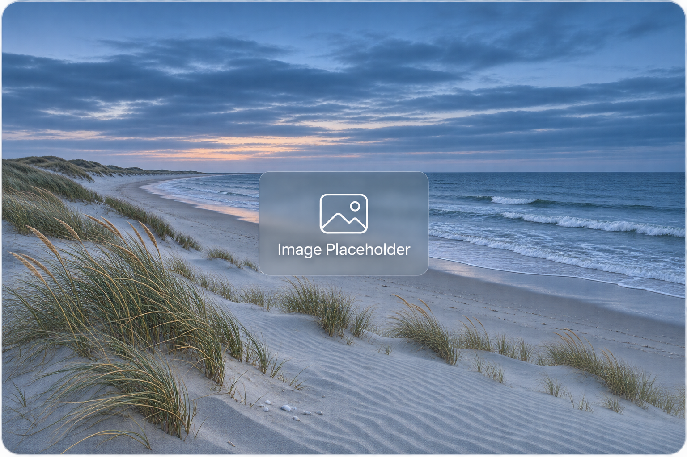
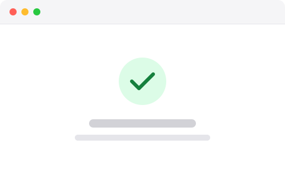

# Images

MDU renders images with standard Markdown syntax. Local image files are copied into the site with their relative paths, and images that can be shown larger open in a viewer when clicked unless you [turn this off](#turn-off-the-viewer).

## Syntax

Add alternative text in square brackets and the image URL in parentheses. An optional title appears when a visitor hovers over the image:

~~~markdown title="Markdown"

~~~

> [!RESULT]
>
> 

The alternative text describes the image to people who use assistive technology, so write it for every image.

## Light and dark variants

Add `#only-light` or `#only-dark` to the end of each image URL to show a different image for each theme. Use the same alternative text for both variants:

~~~markdown title="Markdown"


~~~

MDU shows the matching image when a reader selects light or dark mode. In automatic mode, it follows the reader's system appearance. The GitHub-compatible markers `#gh-light-mode-only` and `#gh-dark-mode-only` work too. Other Markdown viewers may show both variants.

For PDF output, MDU keeps only the light variant. Images appear as alternative text in PDFs.

## Frame screenshots

A white window screenshot on a white page has no visible edge. Add `{.image-frame}` after an image to draw a subtle 1-pixel outline around it. The outline uses a light gray in light mode and a dark gray in dark mode, and the image viewer shows it too:

~~~markdown title="Markdown"
{.image-frame}
{.image-frame}
~~~

> [!RESULT]
>
> {.image-frame}
> {.image-frame}

- The outline follows the visible shape of the image. Transparent areas, such as the rounded corners of a macOS window captured without its shadow, stay transparent and are not cropped.
- The frame adds no shadow, background, or padding on the page. Images without the class look as before.
- With light and dark variants, add the class to each variant.
- The class belongs on the image itself. In raw HTML, write ``.
- Semi-transparent areas inside the image, such as a translucent sidebar, let the outline show through faintly along their edges. Window screenshots captured without their shadow are opaque inside and are not affected.
- While the image has keyboard focus, the focus ring replaces the outline.

## Add a visible caption

Use a figure to give an image a visible caption. Start the figure with `^^^` on its own line and write the caption after the closing `^^^`. The alternative text describes what the screenshot shows, and the caption explains why it matters.

~~~markdown title="Markdown"
^^^
{.image-frame}
{.image-frame}
^^^ Review all three options side by side **before choosing a configuration**, so you can compare their defaults without leaving the settings window.
~~~

> [!RESULT]
>
> ^^^
> {.image-frame}
> {.image-frame}
> ^^^ Review all three options side by side **before choosing a configuration**, so you can compare their defaults without leaving the settings window.

Use the same figure for both theme variants so they share one caption. A figure can also contain a single image. The image viewer displays the caption as plain text and falls back to the alternative text if there is no caption or it is blank.

Other Markdown viewers, including GitHub, may display the `^^^` lines as literal text. For viewers that support raw HTML, use `<figure>` with an `` and a `<figcaption>` as a portable alternative.

PDF output includes the caption as text alongside the image's alternative text. For theme variants, the PDF uses the light image's alternative text.

## Local images

Keep local image files inside the documentation folder and link to them with a relative path from the Markdown file. For example, a page can refer to an image in its own `images` subfolder as `images/page.png`.

`mdu render` and `mdu serve` copy linked local images and keep their relative paths. Supported extensions are `.bmp`, `.png`, `.gif`, `.jpg`, `.jpeg`, `.webp`, `.avif`, and `.svg`. `mdu lint` reports a missing image as `MDU004`. External image URLs are not copied; they load from their original location.

## In the rendered site

- Images scale down to the page width and keep their proportions, so wide images fit small screens.
- Click an image with a zoom cursor to open it in a full-window viewer that shows the whole image. If such an image has alt text, it is also a tab stop, so ++enter++ opens it. Close it with its close button, by clicking beside the image, or with ++esc++.
- An image larger than the window can be zoomed and panned. Zoom by scrolling vertically with the mouse wheel or trackpad, with a pinch, the toolbar, or ++plus++ and ++minus++; click the image to zoom in on that spot and click again to fit it back. Drag, scroll sideways, or use the arrow keys to pan. ++0++ fits the image to the window and ++1++ shows its actual size.
- A pixel image already shown at its full size does not open the viewer and has no zoom cursor, because the viewer could not show it larger. Add `{.image-zoom-on}` to open it anyway. SVG images grow up to three times their size and can always be zoomed, because they stay sharp.
- An image that links to another page keeps its link; an image that links to its own file opens the larger view.
- Images that should not open the viewer, such as logos or layout graphics, can [turn it off](#turn-off-the-viewer).

## Turn off the viewer

The viewer is on by default. Choose the smallest scope that fits:

| Scope | Markdown |
| --- | --- |
| A whole page | `images.zoom: false` in the front matter |
| One image | `{.image-zoom-off}` after the image |
| One image on a page without the viewer | `{.image-zoom-on}` after the image |

Set `images.zoom` in a page's front matter to turn off the viewer for every image on the page:

```yaml title="Front matter"
---
images.zoom: false
---
```

The nested form `images: { zoom: false }` works as well. `mdu lint` reports any other value than `true` or `false` as [`MDU024`](../Usage/lint/Rules.md#mdu024-invalidimagezoom), and also `images: false` without `zoom`. Other `images` values, such as a list of pictures, are left alone.

Add a class to an image to decide for that image alone. The class wins over the page setting:

```markdown title="Markdown"
{.image-zoom-off}

{.image-zoom-on}
```

- An element around an image can carry the class too, such as `<figure class="image-zoom-off">`. The closest class to the image counts.
- Renderers without attribute support, such as GitHub, show `{.image-zoom-off}` as text. Use an HTML `` with the class if the page must stay readable there.

## Galleries

Wrap related images or figures in `<div class="image-gallery">` to show a step-by-step guide. Leave a blank line inside each end of the container and between steps so MDU parses each step as its own image paragraph or figure. Use a figure to add instructions as a caption. Previous step and Next step browse the guide directly on the page, even when image zoom is disabled.

~~~markdown title="Markdown"
<div class="image-gallery">


^^^

^^^ Select a configuration to review its details.



</div>
~~~

> [!RESULT]
>
> <div class="image-gallery">
>
> 
> 
>
> ^^^
> 
> ^^^ Select a configuration to review its details.
>
> 
>
> </div>

To see a larger view, open the current image and use the Previous image and Next image buttons. The position shows where you are in the gallery. Navigation stops at the first and last images. With an image fitted to the window, ++left++ and ++right++ browse the gallery. While zoomed in, the arrow keys pan the image, and the buttons still let you browse. Each image change resets the zoom to fit. Press ++esc++ to close the viewer and show the current step on the page and return focus to its image.

Put light and dark variants directly next to each other, either in the same figure or as consecutive images without a blank line between them. They share one step, and the viewer counts and shows only the visible variant. Without JavaScript, MDU shows all steps in order. Other Markdown viewers may show the images inline, including both variants, and display figure markers as literal text.
