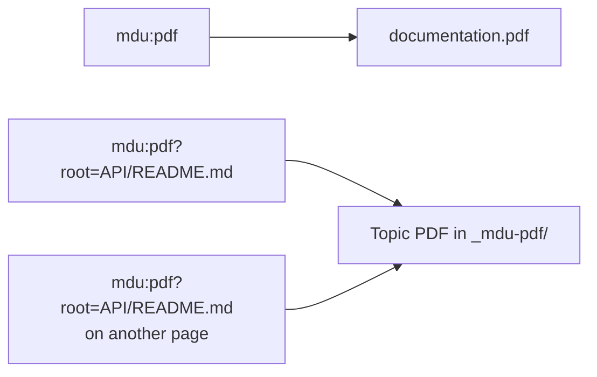

# PDF Link

Offer your documentation as a PDF download. Put a link to `mdu:pdf` on any page, and `mdu render` and `mdu serve` generate the PDF and point the link to it. There is nothing to configure and no extra build step.

## Syntax

Place the link anywhere in your Markdown and choose its label:

```markdown title="Markdown"
[Download Documentation as PDF](mdu:pdf)
```

The rendered link looks like any other link in the text and works on every page, including pages in nested folders:

[Download Documentation as PDF](mdu:pdf)

> [!TIP]
> An [icon](Icons-and-Emojis.md) makes the download easier to spot:
>
> ```markdown
> [:material-file-pdf-box: PDF](mdu:pdf)
> ```
>
> This renders as [:material-file-pdf-box: PDF](mdu:pdf).

## Choose what to export

| Link | Exports |
| --- | --- |
| `mdu:pdf` | The whole documentation in navigation order, downloaded as `documentation.pdf` |
| `mdu:pdf?root=API/README.md` | One topic: the selected page and its subpages, downloaded under the page title, such as `API.pdf` |

Every export starts with a title page and a linked table of contents. [Excluded content](#exclude-content) is removed from every export.

### Export one topic

Add `?root=` with the path of a Markdown page. The PDF contains that page and all its descendants in the navigation tree, but not its siblings or ancestors:

```markdown title="Markdown"
[This topic as PDF](mdu:pdf?root=README.md)
[API as PDF](mdu:pdf?root=../API/README.md)
[Guide as PDF](mdu:pdf?root=User%20Guide/README.md)
```

This page as a PDF of its own: [PDF Link as PDF](mdu:pdf?root=Pdf-Link.md)

- The path is relative to the Markdown page that contains the link.
- It must point to a Markdown page inside the documentation.
- Encode spaces as `%20`.

> [!IMPORTANT]
> A root that does not identify a Markdown page in the documentation fails the render, so a broken download never reaches your readers. While `mdu serve` is running, it reports the error and keeps updating pages; the link stays unresolved until you fix it.

The command-line equivalent is [`mdu pdf --page`](../Usage/pdf.md#export-a-topic-and-its-subpages).

## Exclude content

Exclude whole pages, a heading with its section, or any range of content from the PDF while keeping it on the website. See [Exclude content](../Usage/pdf.md#exclude-content) for the syntax and rules.

> [!IMPORTANT]
> Invalid exclusion markers fail `mdu render` and the start of `mdu serve`, just like an invalid root.

## Where the links work

- **Every Markdown page**, at any folder depth.
- **OpenAPI descriptions** rendered from an [`openapi` block](OpenAPI.md). Their root paths are relative to the Markdown page that contains the block.
- **[Repository imports](Repository-Imports.md).** Paths refer to the location in the assembled site, not in the source repository or MDU's cache. An import declaration, such as `API.md`, can be a root too.

## How downloads are generated



- **Only on request.** MDU generates a PDF only when at least one link requests it. Without a PDF Link, no PDF is written.
- **One file per selection.** The full documentation is written to `documentation.pdf` in the output folder. Topic PDFs are written to the reserved `_mdu-pdf/` folder with stable generated filenames. Links that select the same root share one file.
- **Always current.** A full render regenerates every requested PDF. During `mdu serve`, a Markdown change regenerates only the PDFs whose selected content changed or whose file is missing. When the last link to a PDF is removed, the PDF is deleted.
- **Link with `mdu:pdf`, not with filenames.** The generated filenames are an implementation detail; always link with `mdu:pdf` or `mdu:pdf?root=...`.

<details>
<summary>How the suggested filename is chosen</summary>

Topic download links suggest a filename through the HTML `download` attribute; the URL stays unchanged. The filename is the selected page's title, cleaned up for file systems:

- Icon and known emoji shortcodes are removed.
- Consecutive whitespace is collapsed.
- Characters that are unsuitable for filenames are replaced.

If the title is empty, MDU uses the page's filename without `.md`. For a `README.md` or `index.md` page, it uses the name of its folder in the assembled site. Downloads of the whole documentation are named `documentation.pdf`.

</details>

## Related

- [`mdu pdf`](../Usage/pdf.md) writes the same PDF from the command line and describes how pages and elements look in the PDF.
- The PDF uses the same Markdown pipeline as the website, including syntax highlighting, math, callouts, and supported diagrams.
